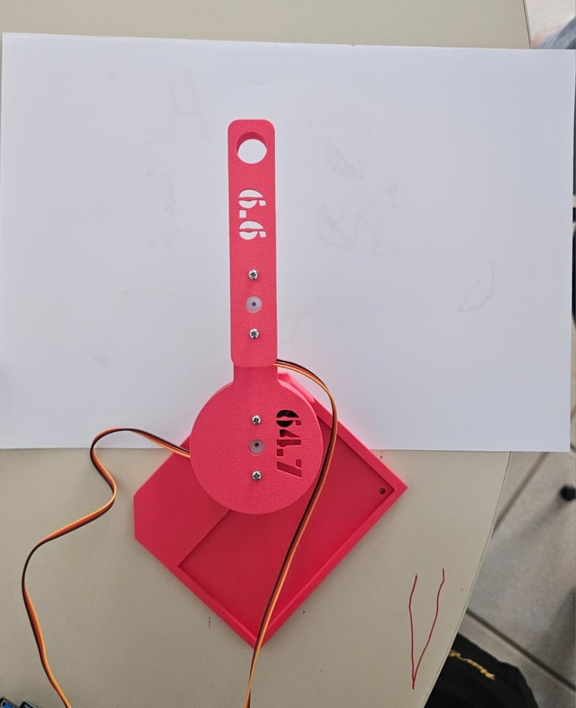
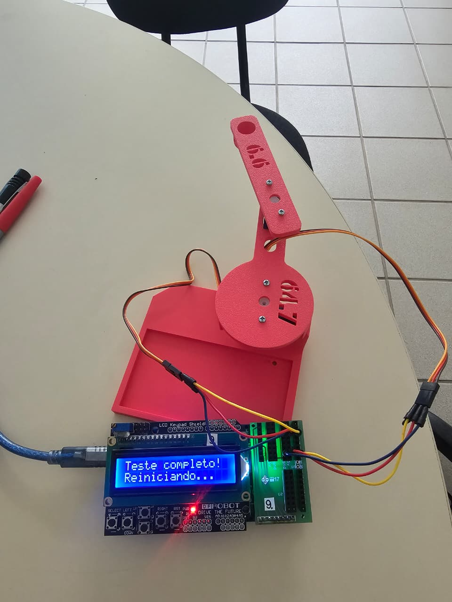
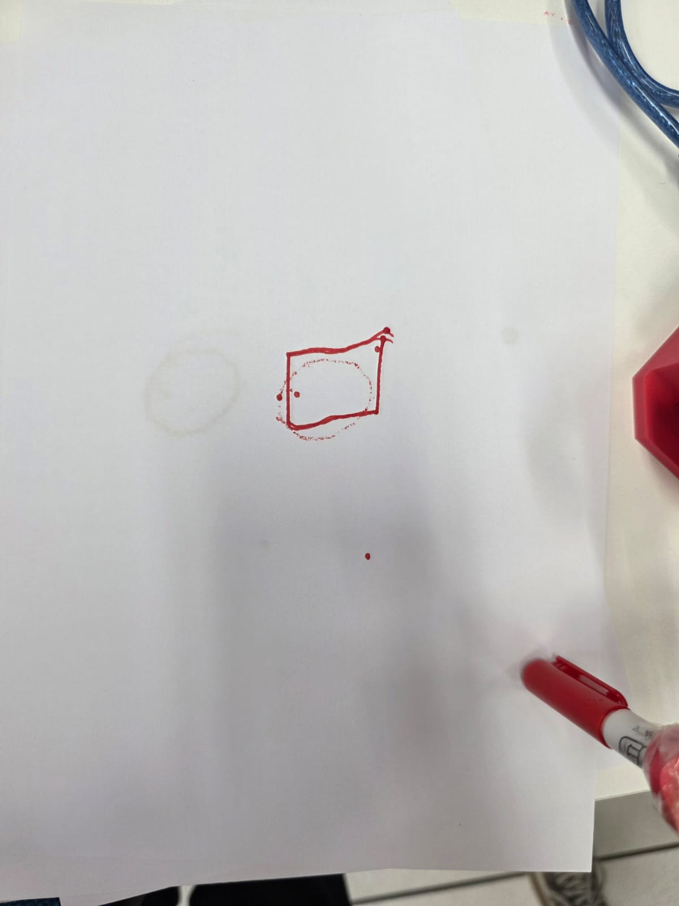
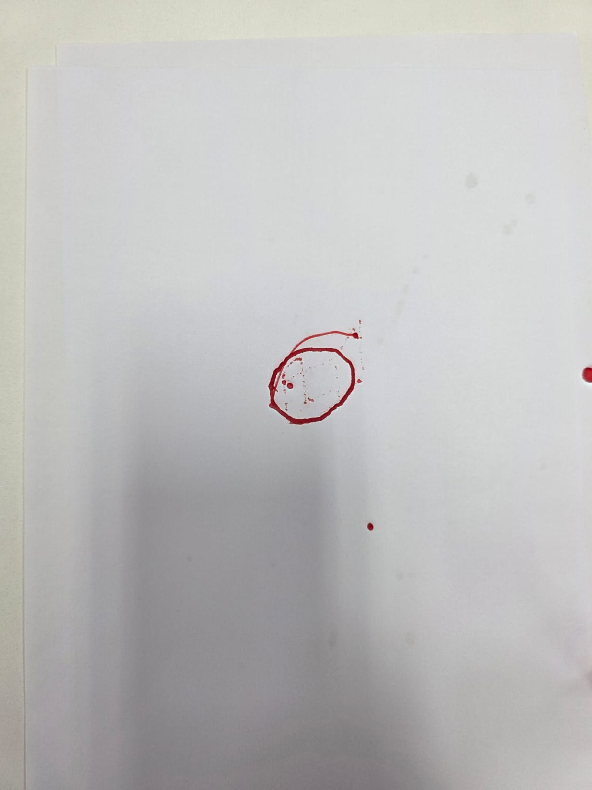
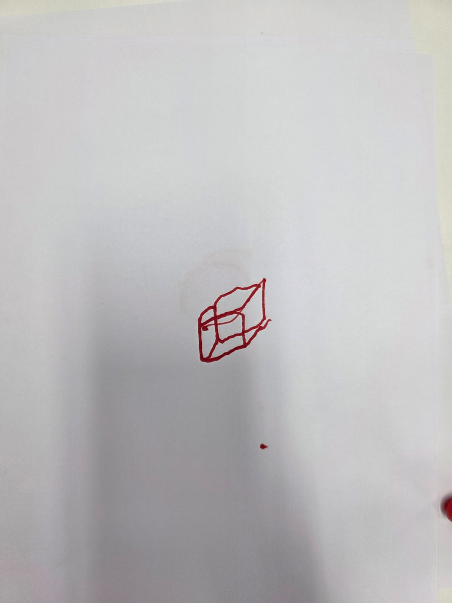
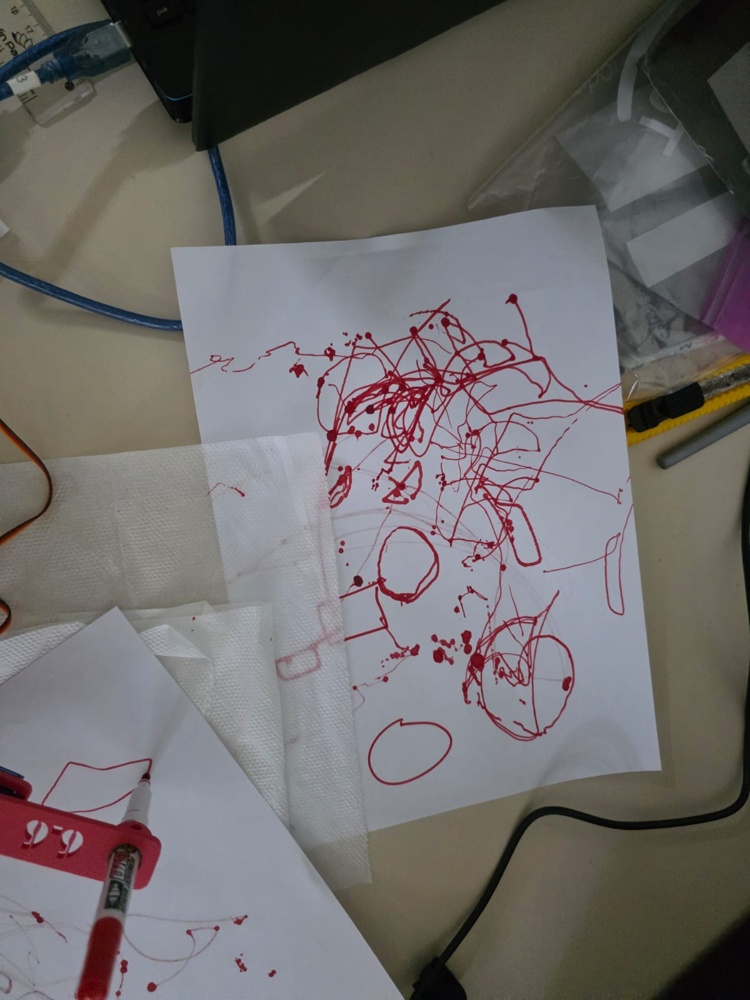

# Trabalho Prático 1 – Robô Artista

## Integrantes do Grupo:

- Vinicius Trindade Dias Abel  – Matrícula: 2020007112

- Guilherme Buxbaum Marinho Guerra

- Lucas Ferreira Gomes

- Ricardo Jianhong Li

- Matheus Gonçalves Pinheiro de Menezes

Disciplina: Introdução à Robótica 

Professor: Hector Ignacio Azpurua Perez Imaz

Data da apresentação: 23/04/2026

# 1. Introdução

Este trabalho teve como objetivo o desenvolvimento de um robô artista, capaz de segurar um marcador e realizar desenhos sobre papel utilizando no máximo dois motores para o movimento do braço.

O projeto envolveu:

Construção mecânica com peças feitas em impressão 3D;
Utilização de Arduino para controle dos motores;
Aplicação de conceitos de cinemática direta e inversa;
Desenvolvimento de algoritmo para desenho automático.

# 2. Conceito do Projeto

## 2.1 Tipo de Manipulador

O manipulador desenvolvido é do tipo planar com dois graus de liberdade (2R), composto por dois elos conectados por juntas rotacionais acionadas por servo-motores com redução.

# 3. Projeto Mecânico
## 3.1 Estrutura


## 3.2 Dimensões do Manipulador

Parâmetro | Valor

Comprimento do Elo 1 | 6,47 cm

Comprimento do Elo 2 | 6,60 cm


## 3.3 Principais Desafios Mecânicos

O desenvolvimento do manipulador envolveu alguns desafios ralacionados a parte mecânica. 

### 3.3.1 Folga no eixo do servo 

Problema observado:
Pequenos erros no posicionamento do marcador.

Causa:
Os servomotores possuem folga interna nas engrenagens. Além disso, o encaixe do servo e a peça impressa apresentava pequena tolerância excessiva.

Solução adotada:
Foi implementado no software um ajuste de offset angular para compensar o erro sistemático observado experimentalmente.


# 4. Eletrônica e Controle

## 4.1 Componentes Utilizados
- Arduino MEGA
- 2 Servo-Motores
- Display LCD
- Shield de sensores


## 4.2 Arquitetura do Sistema

Para a montagem do sistema foi utilizado os shields de display LCD e de sensores ligados na placa do Arduino MEGA. Nesse contexto, os fios dos servo motores foram conectados na placa de sensores para alimentação e para comando. 

Os pinos escolhidos para os servos 1 e 2 foram respectivamente: 25 e 33. 


# 5. Modelagem Cinemática

O objetivo do manipulador é de desenhar formas geométricas no plano cartesiano, foi necessário converter coordenadas cartesianas (x,y) em ângulos das juntas (θ1​,θ2​).

## 5.1 Cinemática Direta

A cinemática direta do manipulador descreve a posição do efetuador final a partir dos ângulos das juntas:

$$
x = L_1 \cos(\theta_1) + L_2 \cos(\theta_1 + \theta_2)
$$

$$
y = L_1 \sin(\theta_1) + L_2 \sin(\theta_1 + \theta_2)
$$

Essas equações representam o modelo geométrico do braço e são utilizadas como base para a obtenção da cinemática inversa.

## 5.2 Cinemática Inversa

Como o objetivo do sistema é posicionar o efetuador em um ponto desejado (x,y), o código implementa a cinemática inversa em duas etapas principais:

Cálculo de θ2: 

$$
\theta2 = -arccos( (x*x + y*y - L1*L1 - L2*L2) / (2*L1*L2) )
$$​

No código, esse valor é cuidadosamente tratado para garantir estabilidade numérica, sendo limitado ao intervalo [−1,1] antes da aplicação da função acos(), evitando erros devido a imprecisões de ponto flutuante.

Cálculo de θ1: 

Para calcular o θ1 utilizamos a seguinte fórmula:

$$
\theta1 =  atan2(y, x) + arccos( (x*x + y*y + L1*L1 - L2*L2) / (2*L1*sqrt(x*x + y*y)) )
$$

## 5.3 Conversão e Ajustes para os Servos

Como os servomotores operam em graus, os ângulos calculados em radianos são convertidos para graus antes de serem enviados aos atuadores.

Além disso, o código implementa um ajuste importante. O Offset aplicado para compensar desalinhamentos mecânico.


# 6. Software Desenvolvido

## 6.1 Estrutura do Código

O software foi estruturado de forma modular para facilitar a manutenção e a expansão das funcionalidades. A lógica é baseada na conversão de coordenadas cartesianas para ângulos dos servos, permitindo que o robô desenhe trajetórias parametrizadas.

- Cinemática Inversa: A função inverseKinematics(x, y, t1_deg, t2_deg) realiza o cálculo geométrico, utilizando as leis dos cossenos para determinar os ângulos necessários para alcançar uma posição (x, y).

- Controle de Movimento: A função moveTo(x, y) converte os ângulos calculados, aplica o offset de 90 graus e envia o sinal para os servomotores via servo.write().

- Interpolação de Trajetória: A função drawLine(x0, y0, x1, y1, steps) divide um segmento de reta em pequenos passos, garantindo que o movimento entre dois pontos seja linear e suave.

- Interface Homem-Máquina: Utiliza um display LCD e uma função de leitura de botões para navegar em um menu interativo para alternar entre os desenhos.

## 6.2 Código Principal

O fluxo principal do programa é gerido pelo menu, que permite ao usuário escolher desenhar qual desenho através de botões:
```
void loop() {
    Button b = readButton();
    switch (b) {
        case BTN_UP:
            menuIndex = (menuIndex - 1 + MENU_COUNT) % MENU_COUNT;
            showMenu();
            break;
        case BTN_DOWN:
            menuIndex = (menuIndex + 1) % MENU_COUNT;
            showMenu();
            break;
        case BTN_SELECT:
            executeMenu(); // Executa: drawSquare, drawCircle ou drawExtra
            break;
        default:
            break;
    }
}
```
# 7. Desenhos Realizados

O robô foi programado para desenhar:

- Um quadrado
- Uma circunferência
- Um cubo
## 7.1 Quadrado

- Tamanho: O quadrado possui 3 cm de lado.
- Estratégia de trajetória: O desenho é realizado posicionando o efetuador em (9.5, -1.5) e utilizando a função drawLine para traçar cada um dos quatro lados com uma resolução de 5 passos por lado .


## 7.2 Circunferência

- Método usado: Utiliza parametrização trigonométrica, onde a posição $(x, y)$ é calculada com base no raio $R = 1.5$ cm e no ângulo $\theta$ que varia de $0$ a $2\pi$.

- Resolução angular: A curva é composta por 240 pontos distintos, garantindo uma transição suave entre as coordenadas.
- Aproximação por pontos: Cada ponto é calculado usando a função moveTo dentro de um laço de repetição, que aproxima a forma circular através de múltiplos segmentos curtos.



## 7.3 Cubo

- Escolha realizada: Foi implementado um cubo tridimensional em perspectiva

- Estratégia de implementação: O desenho utiliza uma série de coordenadas para os vértices frontais (A a D) e traseiros (E a H) , com um deslocamento de 0.8 cm em X e Y para gerar o efeito de profundidade.

- Dificuldades encontradas: A principal complexidade foi o planejamento do caminho euleriano , que exigiu o traçado de 16 segmentos de linha, incluindo o retrabalho de algumas arestas para garantir que o contorno do cubo fosse desenhado corretamente com o efetuador sem levantar a caneta. 



# 8. Principais Desafios Encontrados



- Precisão das retas: Para garantir que as linhas fossem desenhadas de forma contínua e precisa, aumentamos o número de pontos calculados durante a interpolação das trajetórias.
- Cinemática inversa: Devido à necessidade de converter coordenadas cartesianas $(x, y)$ em ângulos de junta $(\theta_1, \theta_2)$, foram realizadas alterações e ajustes específicos nas equações trigonométricas para garantir o correto posicionamento do efetuador final.
- Imperfeições na montagem: Problemas de folga interna nos servomotores e tolerâncias nas peças impressas em 3D causaram desalinhamentos. Como solução, implementamos um ajuste de offset angular no software para compensar o erro sistemático observado durante a calibração.


# 9. Funcionalidades 

## 9.1 Display LCD 

Como funcionalidade extra, foi implementada uma interface com display LCD, permitindo a seleção dos desenhos diretamente no robô, sem necessidade de alterar o código a cada execução. O display foi integrado ao Arduino e passou a atuar como uma interface homem-máquina, tornando o sistema mais interativo e organizado.

Ao iniciar o sistema, o LCD exibe um menu com as opções disponíveis : Quadrado, Circunferência e Surpresinha (Cubo). A navegação entre as opções é realizada por meio de botões conectados ao Arduino, possibilitando alternar entre os desenhos e confirmar a escolha. Após a seleção, o programa executa a rotina correspondente.

# 10. Vídeos

Vídeo de funcionamento: 
https://youtube.com/shorts/lLdkEeVSDGU 

[](https://www.youtube.com/watch?v=lLdkEeVSDGU)
# 11. Conclusão

O desenvolvimento do robô artista permitiu integrar, de forma prática, conceitos de mecânica, eletrônica e programação aplicados à robótica. Ao longo do projeto, foi possível compreender como a modelagem matemática se traduz em movimento real, mostrando a importância da cinemática para o controle da posição do efetuador final.

A construção mecânica, feita com peças impressas em 3d facilitou muito o processo de montagem. Entretanto é importante reforçar que esse método possui imperfeições como folgas, e desalinhamentos que podem gerar erros para o braço. Dessa forma, é necessário a compensação desses erros por meio de offsets, além de calibração no equipamento. 

Na parte de controle, a implementação em Arduino possibilitou aplicar conceitos de interpolação de trajetória e organização modular do código, além da integração com o display LCD para seleção dos desenhos, tornando o sistema mais interativo e funcional. O robô foi capaz de desenhar as formas solicitadas dentro da área de trabalho, atendendo aos requisitos do projeto.

De forma geral, o trabalho proporcionou uma visão completa do processo de desenvolvimento de um sistema robótico, desde o projeto mecânico até a implementação do software de controle, consolidando os conhecimentos de cinemática e demonstrando a importância da integração entre teoria e prática.
