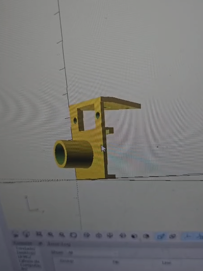

# Trabalho Prático 2 – Robô Móvel e Identificação de Cores

## Integrantes do Grupo
- Vinicius Trindade Dias Abel – Matrícula: 2020007112
- Guilherme Buxbaum Marinho Guerra
- Ricardo Jianhong Li
- Matheus Gonçalves Pinheiro de Menezes

**Disciplina:** Introdução à Robótica  
**Professor:** Hector Ignacio Azpurua Perez Imaz  
**Data da Apresentação:** 26/05/2026

---

# 1. Introdução

Este trabalho prático teve como objetivo o desenvolvimento de um robô móvel autônomo utilizando a plataforma Arduino Mega 2560, capaz de executar trajetórias geométricas predefinidas, detectar obstáculos e identificar blocos coloridos no ambiente.

O sistema foi desenvolvido utilizando controle diferencial com dois motores DC, sensor de distância, encoders, e um sensor de cor TCS34725. Além disso, foi implementada uma arquitetura baseada em máquina de estados finitos (FSM).

As principais funcionalidades implementadas foram:

1. Execução de trajetórias geométricas (reta, triângulo e quadrado);
2. Controle de malha fechada para deslocamento em linha reta;
3. Detecção de obstáculos utilizando sensor ultrassônico HC-SR04;
4. Identificação de blocos coloridos;
5. Reação automática baseada na cor detectada;
6. Interface de interação via LCD Keypad Shield;
7. Sistema de calibração de cores com armazenamento em EEPROM.

---

# 2. Projeto Mecânico

## 2.1 Locomoção Diferencial

O robô utiliza uma configuração de direção diferencial composta por:

- Duas rodas motrizes acionadas independentemente;
- Dois motores DC com caixa de redução;
- Duas rodas bobas para estabilidade.

A navegação é realizada através da diferença de pulsos entre as rodas esquerda e direita.

---

# 3. Eletrônica e Controle

## 3.1 Componentes Utilizados

- 1x Arduino Mega 2560;
- 1x Adafruit Motor Shield V2;
- 2x Motores DC com redução;
- 2x Encoders LM393 com disco de 20 furos;
- 1x Sensor ultrassônico HC-SR04;
- 1x Sensor de cor TCS34725;
- 1x LCD Keypad Shield 16x2;
- 8x Pilhas AA;
- Estrutura em acrílico fornecidade pelo professor;
- Suporte impresso em 3D para os sensores de cor e ultrassônico.

---

## 3.2 Sensores Utilizados

### Sensor Ultrassônico HC-SR04

O sensor ultrassônico foi utilizado para medir a distância até obstáculos presentes à frente do robô.

A medição é realizada emitindo um pulso ultrassônico e calculando o tempo necessário para o eco retornar ao sensor.

A distância é calculada por:

$d = \frac{v \cdot t}{2}$

Onde:

- \(d\) é a distância até o objeto;
- \(v\) é a velocidade do som;
- \(t\) é o tempo medido pelo sensor.

No código, a implementação foi feita utilizando os pinos:

- Trigger: pino 41;
- Echo: pino 43.

Foi definido um limite de aproximadamente 2 cm para identificação de paredes.

---

### Sensor de Cor TCS34725

A identificação de cores foi realizada utilizando o sensor TCS34725, conectado ao barramento I2C.

O sensor fornece diretamente os valores das componentes:

- Vermelho (R);
- Verde (G);
- Azul (B);
- Canal Clear (luminosidade total).

Os valores RGB são normalizados pelo Clear para reduzir influência da intensidade luminosa ambiente:

$
r_n = \frac{R}{R+G+B}
$

$g_n = \frac{G}{R+G+B}$

$b_n = \frac{B}{R+G+B}$

Após a normalização, o algoritmo calcula a distância euclidiana entre a leitura atual e os vetores de referência calibrados.

A distância utilizada na classificação é:

$d = \sqrt{(r_n-r_r)^2 + (g_n-g_r)^2 + (b_n-b_r)^2} $

O sistema identifica quatro cores:

- Vermelho;
- Verde;
- Azul;
- Amarelo.

Na fase de calibração, os valores calculados para cada cor são armazenados na EEPROM.

---

# 4. Controle de Movimento

## 4.1 Controle de Trajetória

O robô executa três trajetórias principais:

1. Linha reta;
2. Triângulo retângulo;
3. Quadrado.

Os movimentos são realizados utilizando contagem de pulsos dos encoders.

Os parâmetros calibrados utilizados foram:

- COUNTS_PER_CM = 1.99
- COUNTS_PER_DEG = 0.2016

Esses parâmetros convertem distância e ângulo em quantidade de pulsos necessários.

Os parâmetros foram obtidos experimentalmente para reduzir erros de medição e melhorar a precisão da calibração.

Inicialmente tentou-se definir esses valores de forma teórica, considerando a distância entre as rodas, o diâmetro das rodas e a relação com o encoder, entretanto, os valores funcionaram muito mal na prática.

---

## 4.2 Controle em Linha Reta

Durante deslocamentos lineares, o sistema utiliza um controlador proporcional para reduzir a diferença entre os motores.

O erro entre as rodas é definido como:

$e(t)=pulsos_{esq}-pulsos_{dir}$

A correção aplicada aos motores é dada por:

$u(t)=K_p * e(t)$

O ganho utilizado foi:

- $K_p = 3.0$

O controlador ajusta dinamicamente o PWM de cada motor para manter o robô em trajetória reta.

---

## 4.3 Controle dos Motores

O acionamento dos motores foi realizado utilizando o Adafruit Motor Shield V2.

Os motores foram configurados da seguinte forma:

- Motor esquerdo: porta M1;
- Motor direito: porta M2.

As velocidades utilizadas no projeto foram:

| Movimento | PWM |
|---|---|
| Movimento reto | 75 |
| Aproximação lenta | 60 |
| Giro | 70 |
| Ré | 65 |

---

# 5. Máquina de Estados Finitos (FSM)

O software foi estruturado utilizando uma Máquina de Estados Finitos para permitir multitarefa sem bloqueio.

Os estados implementados foram:

| Estado | Função |
|---|---|
| EST_MENU | Menu principal |
| EST_PASSOS | Execução de trajetórias |
| EST_LINHA | Busca contínua por blocos |
| EST_COR | Identificação de cor|
| EST_CALIB | Calibração das cores |
| EST_PARADO | Robô parado |

A navegação entre estados ocorre por eventos gerados pelos sensores e pelos botões do LCD Keypad Shield.

---

# 6. Reação aos Blocos

Quando um bloco é detectado, o robô abandona imediatamente o trajeto atual e executa uma reação específica baseada na cor identificada.

As reações implementadas foram:

| Cor Detectada | Reação |
|---|---|
| Vermelho | Giro de 360° e parada |
| Verde | Giro de 90° para esquerda |
| Azul | Giro de 90° para direita |
| Amarelo | Giro de 180° |

Antes da reação, o robô realiza um pequeno movimento de ré.

---

# 7. Interface com Usuário

O sistema utiliza um LCD Keypad Shield 16x2 para interação com o usuário.

As funcionalidades disponíveis no menu foram:

1. Linha reta;
2. Triângulo;
3. Quadrado;
4. Identificação de cor parado;
5. Linha reta + identificação de blocos;
6. Calibração de cores.

Os botões do shield são lidos através do pino analógico A0.

---

# 8. Calibração das Cores

Foi implementado um sistema de calibração manual para aumentar a robustez da identificação de cores.

Durante a calibração:

1. O usuário posiciona um bloco em frente ao sensor;
2. O botão SELECT é pressionado;
3. Os valores RGB normalizados são armazenados;
4. Os dados são salvos na EEPROM.

Essa abordagem permite recalibrar o robô rapidamente em diferentes ambientes de iluminação.

Além disso, é possível utilizar a tecla 'c' do computador para essa calibração. 

---

# 9. Resultados Obtidos

O robô conseguiu:

- Executar trajetórias geométricas com boa precisão;
- Detectar obstáculos frontais;
- Identificar corretamente blocos coloridos;
- Reagir automaticamente conforme a cor detectada.

A utilização dos encoders associada ao controle proporcional melhorou significativamente o deslocamento em linha reta.

---
# 10. Principais desafios

## 10.1 Dificuldades com o protocolo I2C

Inicialmente, o projeto foi planejado utilizando o sensor de distância VL53L0X ao invés do sensor ultrassônico HC-SR04. O VL53L0X foi escolhido por apresentar maior precisão. Entretanto, durante os testes práticos foram encontrados problemas relacionados ao barramento I2C do sistema.

Os dois sensores compartilham o mesmo endereço, seria necessio uma alteração por software na biblioteca para o funcionamento dos dispositivos. 

Devido ao tempo disponível para desenvolvimento e visando aumentar a confiabilidade da apresentação final, optamos por substituir o VL53L0X pelo sensor ultrassônico HC-SR04, que utiliza interface digital simples e apresentou funcionamento estável durante os testes.

## 10.2 Dificuldades na Calibração das Cores

Outro grande desafio do projeto foi a calibração do sistema de identificação de cores.

Mesmo utilizando o sensor TCS34725, diversos fatores influenciavam diretamente as leituras RGB:

- Iluminação ambiente;
- Reflexão da superfície dos blocos;
- Distância entre sensor e objeto;
- Sombras;
- Diferenças de tonalidade entre materiais.

Inicialmente, pequenas variações de iluminação causavam classificações incorretas entre as cores, principalmente entre branco e o amarelo em ambientes pouco iluminados.

Para minimizar esses problemas, foram implementadas diversas estratégias:

- Normalização dos valores RGB;
- Definição de limites mínimos de saturação;
- Sistema de calibração manual;
- Armazenamento das referências na EEPROM.

Mesmo assim, foi necessário realizar múltiplas calibrações em bancada até obter resultados consistentes.

## 10.3 Projeto do Suporte em Impressão 3D

Foi desenvolvido um suporte em impressão 3D para integrar simultaneamente o sensor de cor TCS34725 e o sensor de distância do robô.

O suporte foi projetado utilizando o software OpenSCAD, com o objetivo de organizar melhor o cabeamento, garantir fixação rígida dos sensores e melhorar o alinhamento das leituras.

No caso do sensor de cor TCS34725, o posicionamento foi definido para manter distância e inclinação constantes em relação aos blocos coloridos. Além disso, a geometria do suporte ajudou a reduzir interferências causadas pela iluminação ambiente, melhorando a estabilidade da calibração das cores.

---
# 11. Vídeos

Função 1 Linha: 
https://youtube.com/shorts/4XjOQHh0SsA?si=qOlbcX6857L5sXXw

Função 2 Triângulo: 
https://youtube.com/shorts/Du9c8kfZC_0?si=ypqsq6c7yKtJYARj

Função 3 Quadrado: 
https://youtube.com/shorts/qA_gOd_U2iE?si=LiqTmvNq-tOH7dGl

Função 4 Cor: 
https://youtube.com/shorts/4XjOQHh0SsA?si=qOlbcX6857L5sXXw

Função 5 Linha e bloco: 
https://youtu.be/ry4UsHiSBw4?si=2yFF2btTRhSEwHMc

---

# 12. Conclusão

O trabalho permitiu integrar conceitos fundamentais de robótica móvel, eletrônica embarcada, sensores, controle e programação concorrente.

O sistema desenvolvido demonstrou capacidade de navegação autônoma, percepção do ambiente e tomada de decisão baseada em sensores.

A arquitetura baseada em máquina de estados finitos mostrou-se eficiente para implementação multitarefa em sistemas embarcados utilizando Arduino.

---

