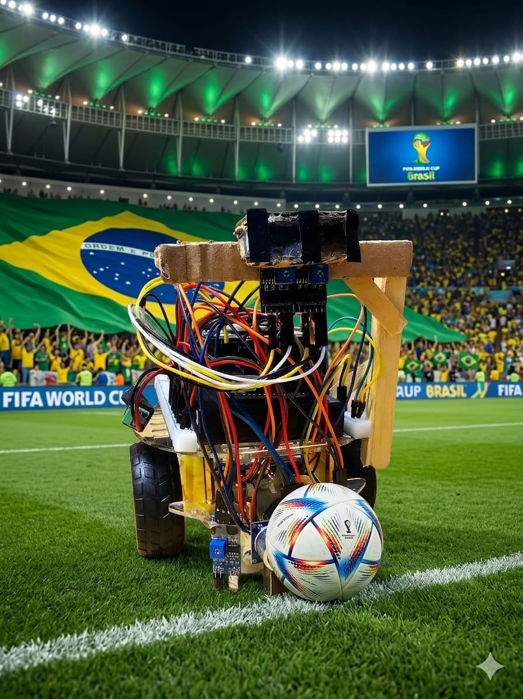
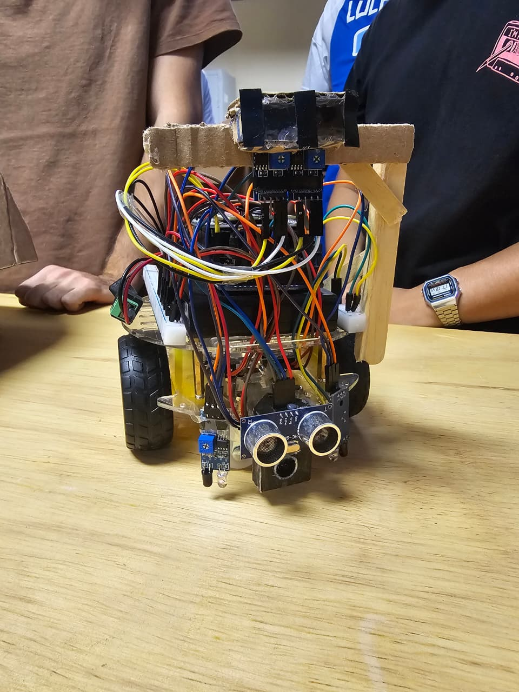

# Trabalho Prático – Percepção e Malha fechada

## Integrantes do Grupo

* Vinicius Trindade Dias Abel – Matrícula: 2020007112
* Guilherme Buxbaum Marinho Guerra
* Ricardo Jianhong Li
* Matheus Gonçalves Pinheiro de Menezes

**Disciplina:** Introdução à Robótica

**Professor:** Hector Ignacio Azpurua Perez Imaz

---



# 1. Introdução

Este projeto consiste no desenvolvimento de um robô móvel autônomo utilizando a plataforma **Arduino Mega 2560**, capaz de realizar tarefas de navegação, localização por luz, seguimento de linha e deslocamentos controlados utilizando odometria.

A proposta do trabalho é uma expansão em relação à versão anterior do trabalho, incorporando novos requisitos de percepção do ambiente, controle em malha fechada e uma nova arquitetura modularizada do código.

O sistema desenvolvido permite:

* Selecionar tarefas através de um menu no LCD;
* Aguardar o sinal de início através da detecção da luz de partida;
* Localizar automaticamente a direção da fonte luminosa;
* Executar trajetórias utilizando odometria;
* Controlar velocidade com controlador PD;
* Seguir linhas;
* Detectar obstáculos;
* Identificar blocos e realizar desvio automático.

---

# 2. Arquitetura do Sistema

Uma das principais alterações desta versão foi a reorganização completa do software em uma arquitetura modular.

Anteriormente o código era um único arquivo .ino. Nesta nova versão, cada responsabilidade foi separada em módulos independentes.

O projeto foi organizado utilizando a estrutura padrão do PlatformIO.

## Estrutura do Projeto

```text
RoboMovelPercepcao/
│
├── include/                  
│   ├── armazenamento.h
│   ├── botoes.h
│   ├── config.h
│   ├── display.h
│   ├── encoders.h
│   ├── modos.h
│   ├── motores.h
│   ├── movimento.h
│   ├── passos.h
│   └── sensores.h
│
├── src/
│   ├── main.cpp              
│   ├── config.cpp            
│   │
│   ├── controle/
│   │   ├── modos.cpp         
│   │   ├── movimento.cpp     
│   │   └── passos.cpp        
│   │
│   ├── hardware/
│   │   ├── armazenamento.cpp 
│   │   ├── botoes.cpp        
│   │   ├── display.cpp       
│   │   ├── encoders.cpp      
│   │   └── motores.cpp       
│   │
│   └── sensores/
│       └── sensores.cpp      
│
├── lib/                     
│
├── test/                     
│
├── platformio.ini            
│
└── SENSORSPINS.md            
```
---

# 3. Plataforma Mecânica



## Locomoção Diferencial

O robô utiliza direção diferencial composta por:

* Dois motores DC independentes;
* Duas rodas bobas.


---

# 4. Hardware Utilizado

## Controlador

* Arduino Mega 2560

## Acionamento dos motores

* Motor Shield V2

## Sensores

### Sensores de Localização

* 2× LDR superiores (Filtros polarizados)
* 1× LDR inferior (luz de partida)

### Odometria

* 2× sensores break-beam
* 2x Disco encoder acoplado às rodas

### Navegação

* 2x Sensores ópticos reflexivos (seguidor de linha)

### Obstáculos

* 1x Sensor de distância ultrassonico HC-SR04

### Cores

* 1x Sensor de cor TCS34725

### Interface

* LCD Keypad Shield 16×2

---

# 5. Localização por Luz

## 5.1 Alinhamento com a Fonte Luminosa

O alinhamento usa dois LDRs com filtro polarizador, montados em um suporte na frente do robô (entradas analógicas A10 e A11). O filtro polarizador é o que permite distinguir a luz de referência da iluminação ambiente. O procedimento (estado EST_ALINHA) tem três fases:

1. **Aguarda a luz de partida:** parado, monitora o LDR inferior (pino 51). O giro só dispara depois de ver a luz acender e, em seguida, apagar. Se começar com ela ligada, apenas espera apagar.
2. **Varredura de 360°:** gira 360° para a direita em velocidade reduzida (VEL_GIRO_ALINHA = 50) para amostrar melhor. A cada passo lê os dois LDRs e guarda a orientação (em pulsos de encoder) em que o menor valor entre eles (min(esq, dir)) foi o mínimo de toda a volta.
3. **Alinhamento final:** gira até terminar 180° oposto à orientação desse mínimo (giro = 180° − ângulo_do_mínimo, pelo caminho mais curto). Essa orientação com base no valor minimo e não no maximo é proposital, porque como a luz é polarizada, fica mais forte (modulo da variacao) o sinal do LDR que não enxerga em relacao a luz ambiente do que a o LDR que enxerga a luz.

O alinhamento pode rodar isolado (opção 7 do menu) ou automaticamente antes da reta, do quadrado ou do seguidor de linha (opções 1, 2 e 3).


---

## 5.2 Luz de Partida

O robô usa o LDR inferior (pino 51) para detectar a luz de partida. A tarefa só inicia quando essa luz é apagada. Se já começar com a luz apagada, ele espera ela acender e depois apagar para iniciar a atividade.


---

# 6. Odometria e Controle

## 6.1 Shaft Encoder

Cada roda tem um disco com 20 furos lido por um sensor óptico break-beam (LM393). Cada subida de sinal gera uma interrupção que incrementa um contador (encEsq / encDir), com debounce de 1,5 ms por canal para reduzir ruído.

O progresso de um movimento é a média dos dois encoders:

$$
progresso = (Enc_{esq} + Enc_{dir}) / 2
$$

As conversões foram calibradas empiricamente:

* **Distância:** COUNTS_PER_CM = 1,99 pulsos/cm (209 pulsos / 105 cm). Para andar D cm, o alvo é Pulsos_alvo = D × COUNTS_PER_CM.
* **Ângulo:** COUNTS_PER_DEG = 0,2016 pulsos/grau (127 pulsos / 630°). Para girar θ graus, o alvo é Pulsos_alvo = θ × COUNTS_PER_DEG.

Compensação de inércia: os motores desligam alguns pulsos antes do alvo (FOLGA_RETA = 6 nas retas, FOLGA_GIRO = 4 nos giros).

---

## 6.2 Controle PD

Foi implementado controle PD para manter velocidade e trajetória.

Erro:

$$
e(t)=P_{esq}-P_{dir}
$$

O erro é a diferença na contagem dos pulsos dos encoders de cada roda.

Controlador:

$$
u(t)=K_p e(t)+K_d\frac{de}{dt}
$$

Onde:

* (K_p = 3,0) → ganho proporcional;
* (K_d = 2,0) → amortecimento (termo derivativo discreto, e(t) − e(t−1)).

O controle PD atua apenas nas retas, ajustando as duas rodas em sentidos opostos para igualar a contagem dos encoders. Giros e ré usam velocidade fixa.

---

## 6.3 Trajetórias Implementadas

### Movimento em Reta

Comprimentos disponíveis: 10cm à 100cm incrementando em 10cm.

A distancia pode ser escolhida pelo menu.

### Movimento em Quadrado

Comprimentos configuráveis: 10x10cm à 100x100cm incrementando em 10cm o lado do quadrado.

O tamanho do lado é configuravel pelo menu do LCD.

---

# 7. Navegação – Seguir Linha

Foi implementado seguidor de linha utilizando sensores ópticos.

Características:

* linha de 5 cm;
* correção contínua;

## Estratégia

1. Alinha com a luz polarizada (opção 3) ou inicia direto (opção 10);
2. Sai em linha reta da área de partida até encontrar a linha preta;
3. Ao encontrar a linha, passa a segui-la continuamente com os 2 LDRs;
4. Curva suave quando só um sensor vê preto. Nos cantos (dois sensores em preto) gira 80° para o lado do primeiro sensor que viu preto.


---

# 8. Detecção de Obstáculos e Blocos

O ultrassom HC-SR04 permanece ativo durante todo o movimento, lido a cada 80 ms. Os limiares de distância são:

* **8 cm** (DIST_DETECTA): começa a observar e a desacelerar;
* **3 cm** (DIST_COR_MAX): perto o bastante para ler a cor com o TCS34725;
* **2 cm** (DIST_PAREDE): trata como parede e para.

## Identificação da Cor

A leitura do TCS34725 é normalizada pela intensidade (cromaticidade rn, gn, bn = canal / (r+g+b)) e classificada assim:

* muito escuro (clear < 50): sem objeto;
* se bate com a referência branca (distância < 0,010): é a **parede** (branco);
* senão, escolhe a mais próxima entre as 3 cores de bloco (VERMELHO, VERDE, AZUL) por distância euclidiana; se ficar longe demais (> 0,30), não reconhece.

**Usamos apenas VERMELHO, VERDE e AZUL como blocos; o BRANCO serve só para identificar a parede.** 

## Exibição

O LCD apresenta, por exemplo:

```text
Bloco: VERMELHO
```

## Manobra Evasiva

Ao detectar um bloco, o robô:

1. para;
2. mostra a cor no LCD por 1,5 s;
3. gira para a direita e reinicia a tarefa do início:
   * **Reta:** gira 180° e refaz a reta;
   * **Quadrado:** gira 90° e refaz o quadrado;
   * **Seguir linha:** gira 180° e continua seguindo a linha.

## Calibração

Há uma etapa opcional de calibração para adaptar as cores à iluminação de cada ambiente. São 4 capturas: VERMELHO, VERDE, AZUL e a PAREDE branca. Mostre cada alvo a ~4 cm e aperte SELECT (LCD) ou qualquer tecla pelo PC. Para calibrar pelo PC, basta enviar 'c' no monitor serial. Os valores são guardados na EEPROM. Se não calibrar, usa valores padrão.

---

# 9. Máquina de Estados e Menu

## Menu de Operação

Navegação: CIMA/BAIXO movem o cursor, SELECT confirma. O botão ESQ volta ao menu a partir dos modos em execução.

| #  | Opção (LCD)   | O que faz                                                       |
| -- | ------------- | -------------------------------------------------------------- |
| 1  | Reta          | Alinha com a luz e faz: frente N, gira 180°, volta N, gira 180° |
| 2  | Quadrado      | Alinha com a luz e faz 4× (frente N + gira 90° à direita)       |
| 3  | Seguir linha  | Alinha com a luz e segue a linha preta com os 2 LDRs            |
| 4  | Identif cor   | Parado, mostra no LCD a cor do objeto à frente (≤ 3 cm)         |
| 5  | Calibrar cor  | Calibra as 3 cores (vermelho/verde/azul) + a parede branca     |
| 6  | Teste LDR     | Parado, mostra a leitura dos 2 LDRs de alinhamento (A10/A11)    |
| 7  | Alinhamento   | Só o alinhamento com a luz, sem tarefa em seguida              |
| 8  | Reta s/al     | Reta, sem alinhar antes                                         |
| 9  | Quadr s/al    | Quadrado, sem alinhar antes                                     |
| 10 | Linha s/al    | Seguidor de linha, sem alinhar antes                           |

O tamanho da reta e do lado do quadrado é escolhido de 10 em 10 cm (10 a 100 cm) antes de iniciar.

## Estados

O software utiliza uma máquina de estados (FSM).

| Estado        | Função                                                        |
| ------------- | ------------------------------------------------------------- |
| EST_MENU      | Navegação e seleção da tarefa                                 |
| EST_TAMANHO   | Escolha do tamanho (reta/quadrado), de 10 em 10 cm            |
| EST_ALINHA    | Alinhamento com a luz (fases AL_AGUARDA → AL_GIRA → AL_ALINHA) |
| EST_PASSOS    | Executa a lista de passos (reta ou quadrado)                  |
| EST_LINHA     | Seguidor de linha                                             |
| EST_COR       | Identificação de cor (parado)                                 |
| EST_CALIB     | Calibração das cores                                          |
| EST_TESTE_LDR | Leitura dos LDRs de alinhamento (parado)                      |
| EST_PARADO    | Tarefa concluída/parada; SELECT volta ao menu                 |

## Fluxo

* Liga em **EST_MENU**.
* Opções 1/2/8/9 passam por **EST_TAMANHO**; se a opção alinha antes (1/2), vai para EST_ALINHA e depois EST_PASSOS; senão, direto para EST_PASSOS.
* Opção 3 vai para EST_ALINHA e depois EST_LINHA; opção 10 vai direto para EST_LINHA.
* Opção 7 roda EST_ALINHA isolado e termina em EST_PARADO.
* A reação a um bloco acontece **dentro** de EST_PASSOS / EST_LINHA (flag reagindoBloco) — não é um estado separado.
* EST_PASSOS termina em EST_PARADO (trajeto concluído ou parede). Em EST_PARADO, SELECT volta ao menu.

---

# 10. Resultados 

Reta: 
https://youtube.com/shorts/jEZlcJNL4Xc?is=e5uiwd3_5XOtWNRa

[](https://youtube.com/shorts/jEZlcJNL4Xc?is=e5uiwd3_5XOtWNRa)


Quadrado: 
https://youtube.com/shorts/EWDF61XlAJI?is=wjOH21SETYGJUk6q

[](https://youtube.com/shorts/EWDF61XlAJI?is=wjOH21SETYGJUk6q)

Seguir Linha: 
https://youtube.com/shorts/GG7iDhVD8EI?is=1ebvxWu_KVTOIQhp

[](https://youtube.com/shorts/GG7iDhVD8EI?is=1ebvxWu_KVTOIQhp)

> **Obs.:** no momento da gravação a bateria estava fraca, então foi preciso empurrar o robô um pouco quando ele travava. Com a bateria carregada ele segue a linha sozinho.

 Linha e bloco: 
https://youtube.com/shorts/eFeDHeA0oM8?is=UH7f1o3mLCRP-R-0

[](https://youtube.com/shorts/eFeDHeA0oM8?is=UH7f1o3mLCRP-R-0)


---

# 11. Principais Desafios

Durante o desenvolvimento foram enfrentados desafios relacionados a:

* calibração dos LDRs;
* ajuste dos ganhos do controlador PD;
* influência da iluminação ambiente na detecção de cores;
* integração entre múltiplos sensores;
* modularização do software.

---

# 12. Conclusão

O desenvolvimento deste projeto permitiu aplicar na prática conceitos fundamentais de robótica móvel, integração de sensores e controle de movimento.

Foi implementada a localização por luz, controlador PD, seguidor de linha. Dessa forma, o robô passou a executar diferentes tarefas de forma autônoma.

Além das funcionalidades implementadas, a reorganização do código em módulos tornou o sistema mais estruturado, facilitando manutenção, testes e futuras expansões.
